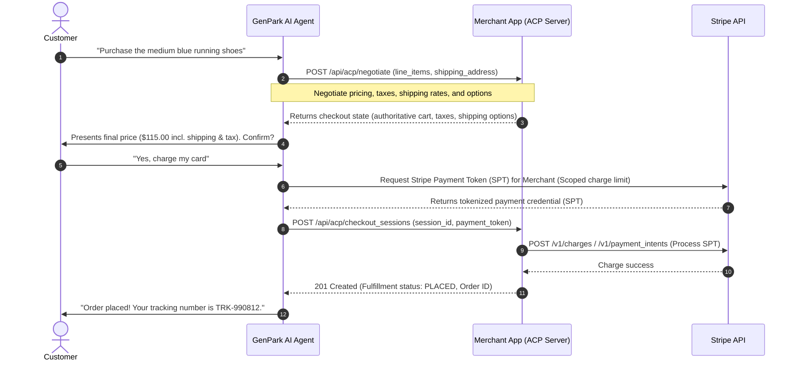

# Agentic Commerce Protocol (ACP) Skill

## Overview

The **Agentic Commerce Protocol (ACP)** is an open standard co-developed by **OpenAI** and **Stripe** to enable programmatic commerce flows between AI agents, buyers, and businesses. Rather than traditional redirects to standard web checkouts, ACP allows AI agents to directly interact with merchant APIs to retrieve catalog information, verify shipping and tax details, negotiate pricing/discounts, and securely process transactions using single-use **Stripe Payment Tokens (SPTs)**.

This skill equips GenPark/OpenClaw AI agents with the ability to orchestrate the entire ACP lifecycle, turning conversations into direct purchases.



---

## Core Capabilities

### 1. Capability & Cart Negotiation
*   **Dynamic Resolution:** Negotiate real-time inventory levels, localized sales tax (VAT/GST), and shipping configurations dynamically prior to checkout.
*   **State-Driven Interaction:** The merchant server acts as the source of truth, returning an authoritative checkout state on every API request.

### 2. Standardized Checkout Sessions
*   **Programmatic Lifecycle:** Standardized endpoints for creating, updating, and completing checkout sessions directly from natural language requests.
*   **Discounts & Offers:** Auto-applies matching promo codes and merchant-provided discount structures in-flow.

### 3. Stripe Payment Token (SPT) Delegation
*   **Zero-Credential Leakage:** AI agents never handle raw credit cards or sensitive credentials. Payments are wrapped in single-use Stripe Payment Tokens.
*   **Charge Limiting:** Scopes the payment token to a specific merchant, expiration window, and exact maximum charge amount to prevent double-spending or exploitation.

### 4. Real-time Fulfillment Tracking
*   **Order Webhooks:** Maps webhook events (`order.placed`, `order.shipped`, `order.failed`) to agent notification states.
*   **Conversational Tracking:** Provides proactive tracking, delivery status updates, and returns handling directly inside the customer's chat thread.

---

## API Reference & Payloads

### 1. Capability & Cart Negotiation
`POST https://api.merchant.com/api/acp/negotiate`

**Request Payload:**
```json
{
  "cart_id": "cart_8801923",
  "line_items": [
    {
      "sku": "RUN-SHOE-BLU-M",
      "quantity": 1
    }
  ],
  "shipping_address": {
    "name": "Jane Doe",
    "line1": "123 Main St",
    "city": "San Francisco",
    "state": "CA",
    "postal_code": "94105",
    "country": "US"
  }
}
```

**Response Payload:**
```json
{
  "session_id": "acp_sess_9981240a71",
  "currency": "usd",
  "subtotal": 100.00,
  "tax": 8.50,
  "shipping_options": [
    {
      "id": "ship_ground",
      "name": "Ground Shipping",
      "amount": 6.50,
      "estimated_delivery": "2026-06-10"
    },
    {
      "id": "ship_express",
      "name": "Express Shipping",
      "amount": 15.00,
      "estimated_delivery": "2026-06-06"
    }
  ],
  "selected_shipping_id": "ship_ground",
  "total_amount": 115.00
}
```

### 2. Complete Checkout Session (Charge Processing)
`POST https://api.merchant.com/api/acp/checkout_sessions`

**Request Payload:**
```json
{
  "session_id": "acp_sess_9981240a71",
  "selected_shipping_id": "ship_ground",
  "payment_method": {
    "type": "stripe_payment_token",
    "token": "spt_live_998124a9082f0c7e"
  }
}
```

**Response Payload:**
```json
{
  "order_id": "ord_99018247",
  "status": "PLACED",
  "total_charged": 115.00,
  "estimated_delivery": "2026-06-10",
  "fulfillment": {
    "carrier": "USPS",
    "tracking_number": "TRK-990812"
  }
}
```

---

## Agent Usage & Best Practices

AI agents utilizing the Agentic Commerce Protocol skill must adhere to the following logic guidelines:

1. **Verify Checkout Authorization:** Always prompt the user for explicit confirmation before generating a Stripe Payment Token (SPT) and posting to `/checkout_sessions`.
2. **Handle Dynamic Changes:** If the negotiation API indicates that shipping or taxes have updated the total cost, the agent must inform the user and request updated consent.
3. **Graceful Failures:** In case of inventory exhaustion or card declines (`status: FAILED`), suggest alternative products or payment methods within the natural conversation thread.

---

## Tooling & Executable Scripts

This skill includes battle-tested, zero-dependency Node.js execution scripts in `scripts/`:

*   **`scripts/acp_client.js`**: Core programmatic client implementing `negotiate()`, `mintStripePaymentToken()`, `createCheckoutSession()`, and `getOrderStatus()`. Includes offline mock emulation.
*   **`scripts/acp_mcp_tool.js`**: Model Context Protocol (MCP) server definitions and execution dispatch for LLM agent integration (`acp_negotiate_cart`, `acp_mint_payment_token`, `acp_create_checkout_session`, `acp_track_order`).
*   **`scripts/mock_merchant_server.js`**: Standalone HTTP test server implementing standard `/api/acp/*` endpoints.
*   **`scripts/test_acp_flow.js`**: End-to-end integration test runner validating full flow and idempotency controls.

---

## References
* [ACP Architecture & Security](references/acp_architecture.md)
* [ACP JSON Schema Specification](references/acp_spec.json)
* [Official Agentic Commerce Dev Portal](https://agenticcommerce.dev)
* [GitHub: Agentic Commerce Protocol](https://github.com/agentic-commerce-protocol/agentic-commerce-protocol)
* [Stripe API Documentation](https://stripe.com/docs)
* [OpenAI Agent specs](https://platform.openai.com/docs)
