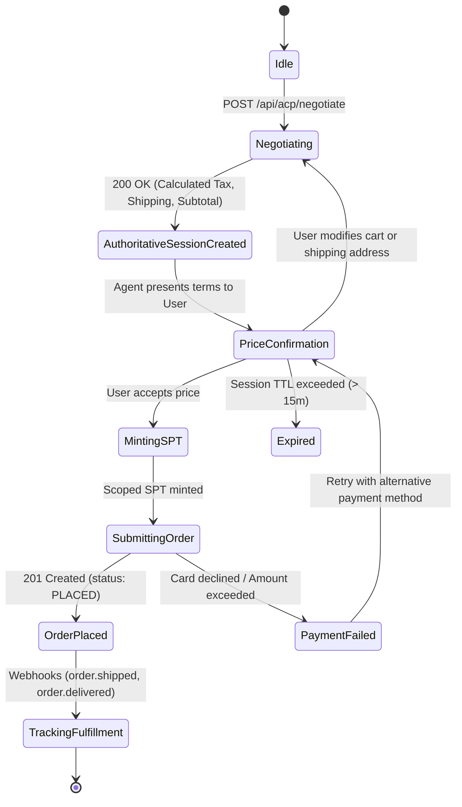

# Agentic Commerce Protocol (ACP) Architecture

This document outlines the architectural specifications, credential delegation principles, and state machine governing the Agentic Commerce Protocol (ACP).

---

## 1. Stripe Payment Token (SPT) Security & Delegation Model

Traditional web checkouts force human redirection to external payment gateways or require merchants to embed iframe fields. In AI Agent-driven commerce, agents cannot and should not handle raw Primary Account Numbers (PANs), CVVs, or persistent card credentials.

### Delegation Workflow

1. **User Authorization & Consent**:
   - The user provides affirmative consent (e.g., "Confirm payment of $115.00").
   - The agent requests a scoped **Stripe Payment Token (SPT)** from the Stripe Agent Delegation API on behalf of the customer.

2. **Scoped Credentials**:
   - **Merchant Bound**: The SPT is cryptographically pinned to the merchant's Stripe account ID (`acct_...`).
   - **Amount Capped**: The token embeds an immutable ceiling (e.g. `max_amount: 115.00 USD`). Attempts by the merchant to charge higher amounts will trigger Stripe API rejection.
   - **Time Limited**: Has a strict TTL (typically 15 minutes) matching the negotiation session lifetime.
   - **Single Use**: Once consumed by `/v1/charges` or `/v1/payment_intents`, the token is invalidated immediately.

```
[Customer]
    | (1. User confirms purchase)
    v
[AI Agent] ----(2. Request Scoped SPT)----> [Stripe Delegation API]
    |                                              |
    | <--(3. Returns SPT: spt_live_...)------------|
    |
    |----(4. POST /api/acp/checkout_sessions)-----> [Merchant Server]
                                                            |
                                                    (5. Charges SPT)
                                                            v
                                                    [Stripe Engine]
```

---

## 2. Session Lifecycle & State Machine



---

## 3. Idempotency & Fault Tolerance

Every checkout execution utilizes a unique client-generated `Idempotency-Key` (UUIDv4) in the HTTP headers and payload body.

- **Network Timeouts**: If a network timeout occurs during session submission, the agent safely retries with the identical idempotency key.
- **Deduplication**: The merchant backend deduplicates calls within a 24-hour window, preventing duplicate card charges or multiple warehouse order dispatches.

---

## 4. Merchant Webhook Events

Merchants emit the following standard webhook events to the agent callback endpoint:

| Event Name | Description | Agent Action |
| :--- | :--- | :--- |
| `acp.order.placed` | Order successfully created and captured | Notifies buyer with Order ID & receipt |
| `acp.order.shipped` | Package handed off to carrier | Provides carrier tracking number & link |
| `acp.order.delivered`| Package marked as delivered | Prompts user for satisfaction & review |
| `acp.order.cancelled`| Order cancelled by store or system | Notifies buyer and confirms refund |
